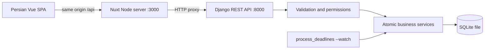

# Architecture

Nuxt serves a client-rendered Vue application and forwards API requests. Browser
cookies stay on one origin; no CORS package or JavaScript-readable auth token is
needed. Sessions use HttpOnly cookies. The CSRF bootstrap endpoint returns a masked
token; the client sends it on mutations and replaces it after login/logout.

One Django domain app is sufficient for this MVP. Models describe storage,
serializers validate API input, viewsets select user-visible resources, and service
functions own business transitions. A custom AbstractUser stores an immutable role
and display name, plus an integer wallet balance. An append-only WalletTransaction
records top-ups, payments and refunds; Reservation stores its captured price and
paid amount. No generic repository layer or unnecessary inheritance is used.

## Transaction strategy

SQLite uses `OPTIONS.transaction_mode = IMMEDIATE`, with a 20-second busy timeout.
Every reservation, cancellation, publication, settlement, and fulfillment operation
runs in `transaction.atomic`. SQLite acquires its database-wide write lock before
the service reads capacity. Concurrent writers wait and then re-read committed data.
This prevents the stale read/check/write race. Database check constraints additionally
reject invalid capacity counters and thresholds.

`select_for_update()` is intentionally harmless on SQLite; safety comes from
BEGIN IMMEDIATE, not row locking. The calls retain a clear locking boundary if the
database is migrated later. SQLite serializes unrelated writes too, so this design
is appropriate for the local academic workload rather than high-throughput commerce.
Transactions are kept short and do not include network calls.

Wallet debits/refunds, their ledger entries, reservation status, and capacity counters
commit together. Wallet rows are locked before balance changes. The same transaction
strategy prevents concurrent purchases from spending the same funds twice.

The campaign row is the serialization point in domain code. Capacity counters and
reservation rows change in the same transaction. Deadline settlement takes the same
lock, checks time and state again, and creates one order per active reservation.
Idempotence is enforced both by terminal campaign states and a unique order relation.

## Tradeoffs

- SQLite is the user's chosen default; no database server is required.
- A simple management command handles deadlines; a separate process must run it.
- Published conditions cannot be changed, avoiding accidental buyer contract changes.
- Integer toman prices avoid decimal rounding ambiguity.
- Client rendering simplifies session state; search-engine rendering can be added later.
- Proxy origin is set at build time via API_UPSTREAM; rebuild when changing it.
- DRF in-memory throttling is suitable locally. Use shared cache and edge controls for public use.

SQLite configuration follows [Django's database documentation](https://docs.djangoproject.com/en/5.2/ref/databases/#sqlite-notes).
