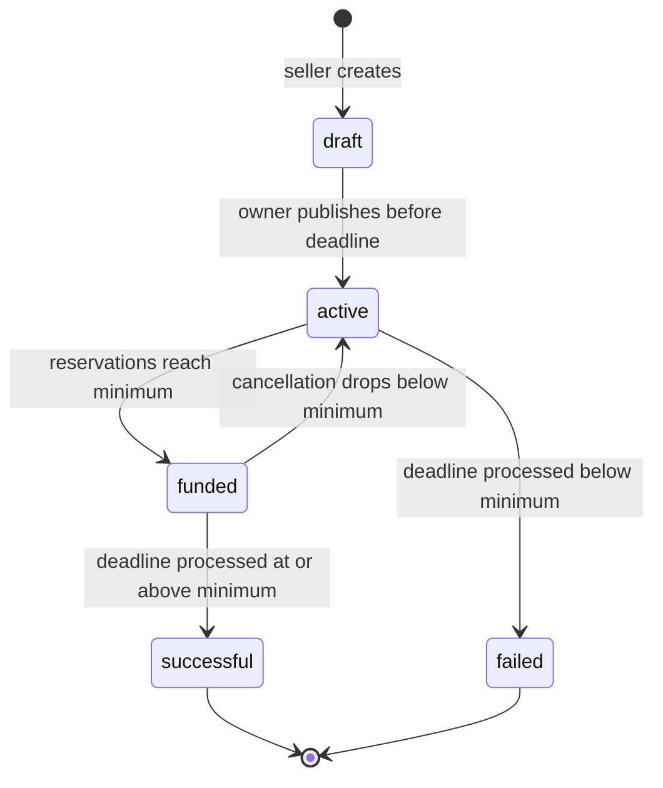
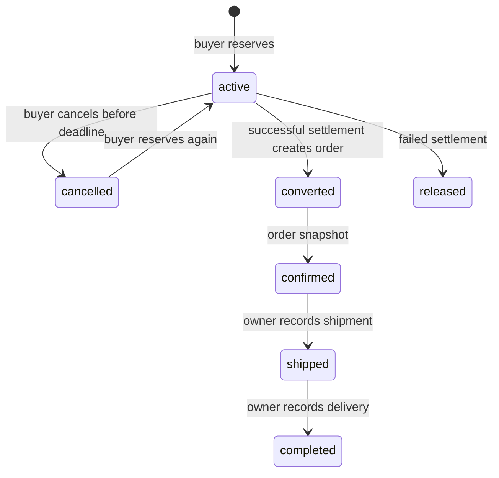

# Business rules

## Campaign lifecycle

Reaching the minimum does not immediately create orders. Reservations remain
cancellable until the deadline. Funded campaigns accept more reservations up to
capacity. The deadline comparison uses server time; at exact deadline, reservation
and cancellation are closed. A delayed worker never extends that deadline.

Every reservation request adds units. The cumulative active quantity for that buyer
must remain within buyer_limit. There is one reservation row per buyer/campaign.
Cancelled rows can be reactivated before deadline, starting again at zero active units.
Sellers cannot reserve. Only the buyer can cancel their own reservation.

## Reservation and order lifecycle

Settlement is atomic and idempotent. An order snapshots unit price and quantity;
total is their product. The price is captured when reserving, and settlement does
not charge the wallet a second time. Cancellation after deadline or after
settlement is rejected. Shipping/delivery records must follow the stated order;
buyers and unrelated sellers cannot change fulfillment status.

Drafts are absent from public listings and detail endpoints. Sellers access their
drafts through `mine=1`. Conditions cannot be edited after creation in this MVP.
Publication revalidates ownership, draft status, and future deadline.

## Demo wallet

New buyers start at zero. The account screen offers fake top-ups between 10,000 and
10,000,000 integer toman per request. No bank, card data, or real money is involved.
Fake top-ups are enabled only in development (`FAKE_WALLET_ENABLED` follows DEBUG).
Each top-up has a unique request UUID; retries with the same user and amount return
the existing result rather than adding credit again.

Reserving debits the wallet and records a payment in the same transaction as the
capacity update. Insufficient funds roll back the entire operation. Adding units
to an active reservation charges only the extra units at its captured unit price.
Cancelling refunds exactly the amount paid and clears it; re-reserving starts a new
payment. Failed deadline settlement refunds active reservations once; successful
settlement retains their payment and creates orders. Wallet entries are immutable
in admin, and balances can only change through services.

Existing reservations from before the wallet migration retain their unit prices
but start with zero paid amount: they produce no retroactive charge or free refund.
Only new payments can be refunded. Existing demo users can top up through the UI;
newly seeded demo buyers receive a recorded fictional starting top-up.

## Demo scenarios

The seed dataset supplies coffee below threshold, olive oil near threshold, honey
at threshold, successful saffron with orders, unsuccessful ceramic with released
reservations, a draft, and a one-slot campaign. All identities are fictional.
Buyer-limit and concurrent-capacity rejection are exercised in automated tests.
