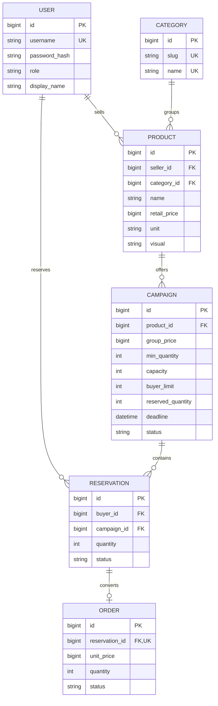

# Database design

All money is integer toman. Timestamps are stored timezone-aware (UTC) and displayed
in Asia/Tehran with the Persian calendar. Django creates foreign-key indexes.

## Invariants

- Product retail price and campaign group price are positive.
- `1 <= min_quantity <= capacity` and `1 <= buyer_limit <= capacity`.
- `0 <= reserved_quantity <= capacity` (positive integer field plus check constraint).
- Reservation quantity is positive; `(buyer_id, campaign_id)` is unique.
- Order reservation is one-to-one; price and quantity are copied at settlement.
- PROTECT relations preserve records referenced by reservations/orders.
- Seller ownership and group-price discount are validated at the API/service boundary.

`reserved_quantity` is a transactionally maintained counter. It counts committed
units for active campaigns and preserves final demand on terminal campaigns.
Cancelled reservations do not count; failed campaign quantities remain as historical
demand rather than currently purchasable stock. Final campaign capacity is never reused.

No API supports direct counter edits. The seed command also uses reservation and
settlement services. Manual SQL/admin edits bypass domain guarantees and are not a
supported application workflow. Migration `0001_initial` defines the reproducible schema.
